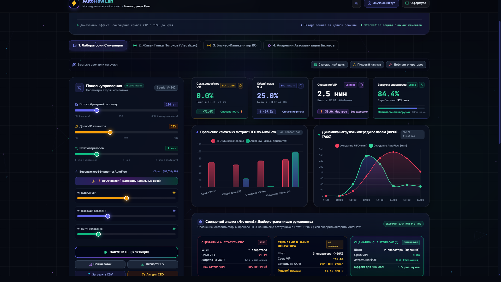
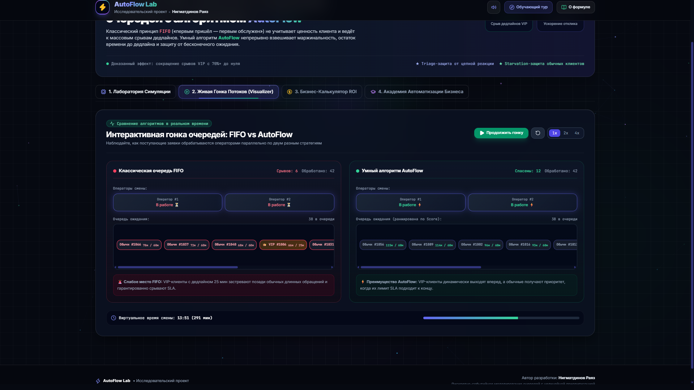
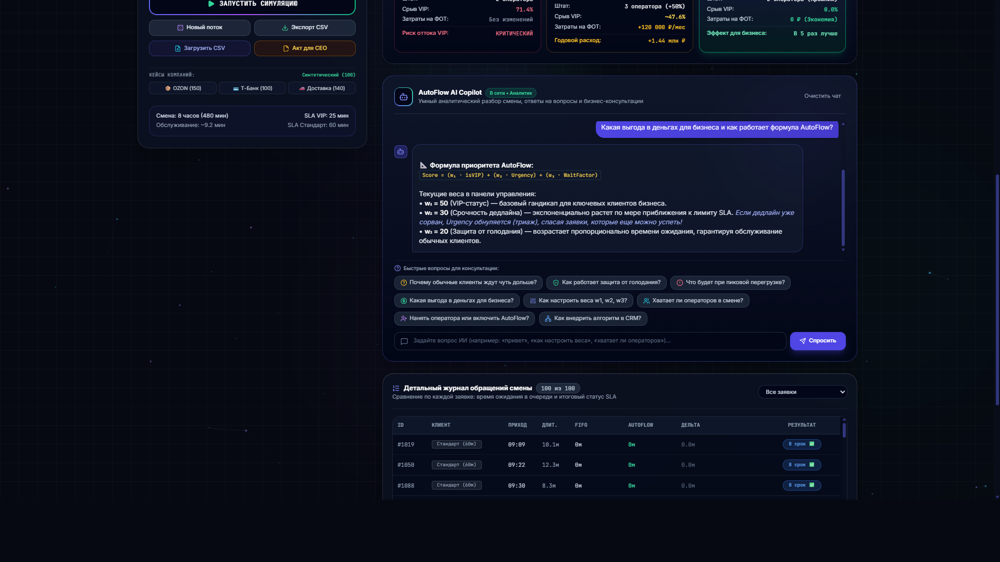

# ⚡ AutoFlow Lab — Интеллектуальная диспетчеризация очередей

[](https://rapihappy.github.io/AutoFlow-Lab/)
[](https://rapihappy.github.io/AutoFlow-Lab/)
[](https://rapihappy.github.io/AutoFlow-Lab/)

> **Фәнни-тикшеренү проекты / Научно-исследовательский проект**  
> **Автор разработки:** Нигматдинов Раяз (Нигъмәтдинов Раяз)  
> 🌐 **Публичный сайт:** [https://rapihappy.github.io/AutoFlow-Lab/](https://rapihappy.github.io/AutoFlow-Lab/)

---

## 📌 О проекте

**AutoFlow Lab** — это интерактивная платформа дискретно-событийного моделирования и автоматизации очередей обслуживания для банков, финтеха, e-commerce и B2B-сервисов.

Классический принцип **FIFO** (*First-In, First-Out* — «первым пришёл, первым обслужен») не учитывает ценность клиента и близость дедлайна, приводя к массовому срыву SLA у ключевых VIP-заказчиков (до 70%+ сорванных сроков).

Разработанный алгоритм **AutoFlow** устраняет эту проблему за счёт трёхфакторного нелинейного динамического скоринга:

$$\text{Score} = (w_1 \cdot \text{isVIP}) + (w_2 \cdot \text{Urgency}) + (w_3 \cdot \text{WaitFactor})$$

Где:
* **$w_1 \cdot \text{isVIP}$** — базовый приоритет маржинальности клиента.
* **$w_2 \cdot \text{Urgency}$** — степень приближения к лимиту SLA ($\frac{\text{Wait}}{\text{SLA}}$) со встроенным **Triage-отсечением**: если заявка уже безнадежно сорвана, её приоритет обнуляется, предотвращая цепную реакцию (эффект домино) на соседние спасаемые заявки.
* **$w_3 \cdot \text{WaitFactor}$** — защита от бесконечного ожидания (*Anti-Starvation*), гарантирующая, что обычные клиенты гарантированно получат обслуживание.

---

## 🖼️ Скриншоты платформы

### 1. Главный дашборд симуляции и KPI


### 2. Живая гонка потоков (FIFO vs AutoFlow)


### 3. Встроенный ИИ-аналитик (AutoFlow Copilot)


### 4. Официальный акт аудита эффективности для руководства


---

## ✨ Ключевые возможности

1. **Двуязычный режим без перезагрузки (🌐 RU / TAT):**
   * Полноценная поддержка русского и татарского языков интерфейса, включая обучающий тур, все 4 вкладки, аналитику ИИ и акт для руководства.
2. **Дискретно-событийный симулятор реального времени:**
   * Мгновенный пересчет 100+ обращений при изменении потока, доли VIP или штата операторов.
3. **Визуализатор «Живая гонка потоков»:**
   * Параллельный конвейер обслуживания, наглядно демонстрирующий разницу FIFO vs AutoFlow на виртуальных часах смены.
4. **ROI Бизнес-калькулятор:**
   * Расчет финансового эффекта в рублях (сохранение LTV, снижение штрафов, оптимизация фонда оплаты труда).
5. **Академия автоматизации и отраслевые шаблоны (Blueprints):**
   * Готовые пресеты для Банкинга, E-Commerce, B2B SaaS и Медицинского триажа.
6. **QR-код для жюри и экспертов:**
   * Мгновенный доступ со смартфонов для интерактивного тестирования симулятора.

---

## 💻 Локальный запуск

Проект написан на чистом ванильном стеке (HTML5, Tailwind CSS, JavaScript ES6+, Chart.js, Lucide Icons) и не требует сборщиков:

```bash
# Клонировать репозиторий
git clone https://github.com/rapihappy/AutoFlow-Lab.git

# Перейти в папку
cd AutoFlow-Lab

# Запустить любой локальный сервер (например, Python)
python -m http.server 5000
```

После этого откройте в браузере: `http://localhost:5000`.

---

## 📄 Лицензия и авторство

* **Автор:** Нигматдинов Раяз
* **Год разработки:** 2026
* **Проект:** Научно-исследовательская работа по дискретно-событийному моделированию очередей и оптимизации бизнес-процессов.
